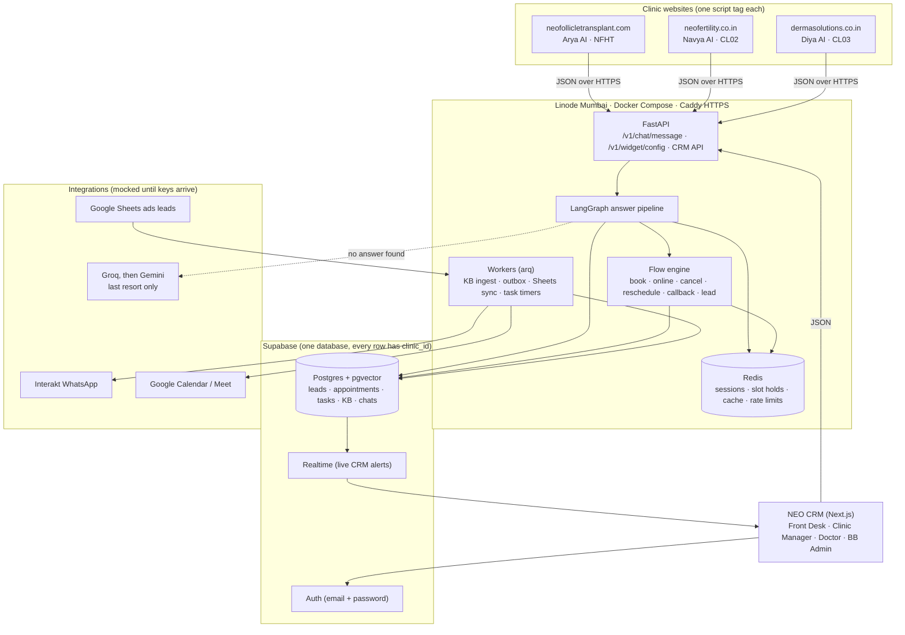
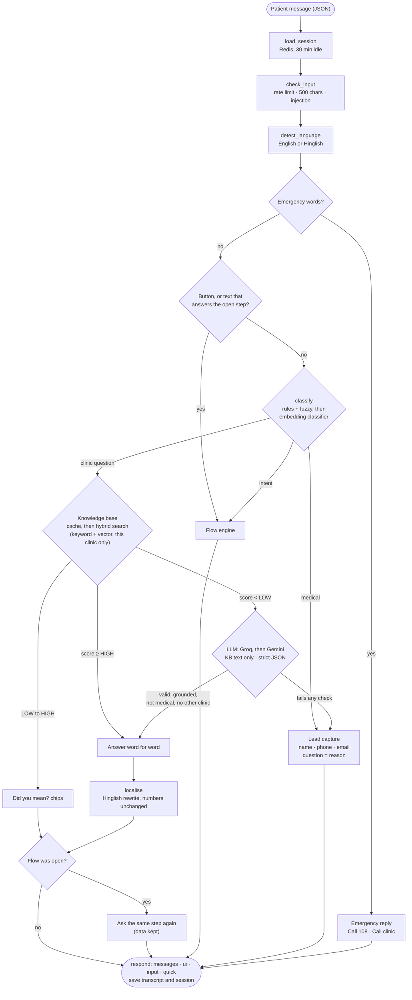
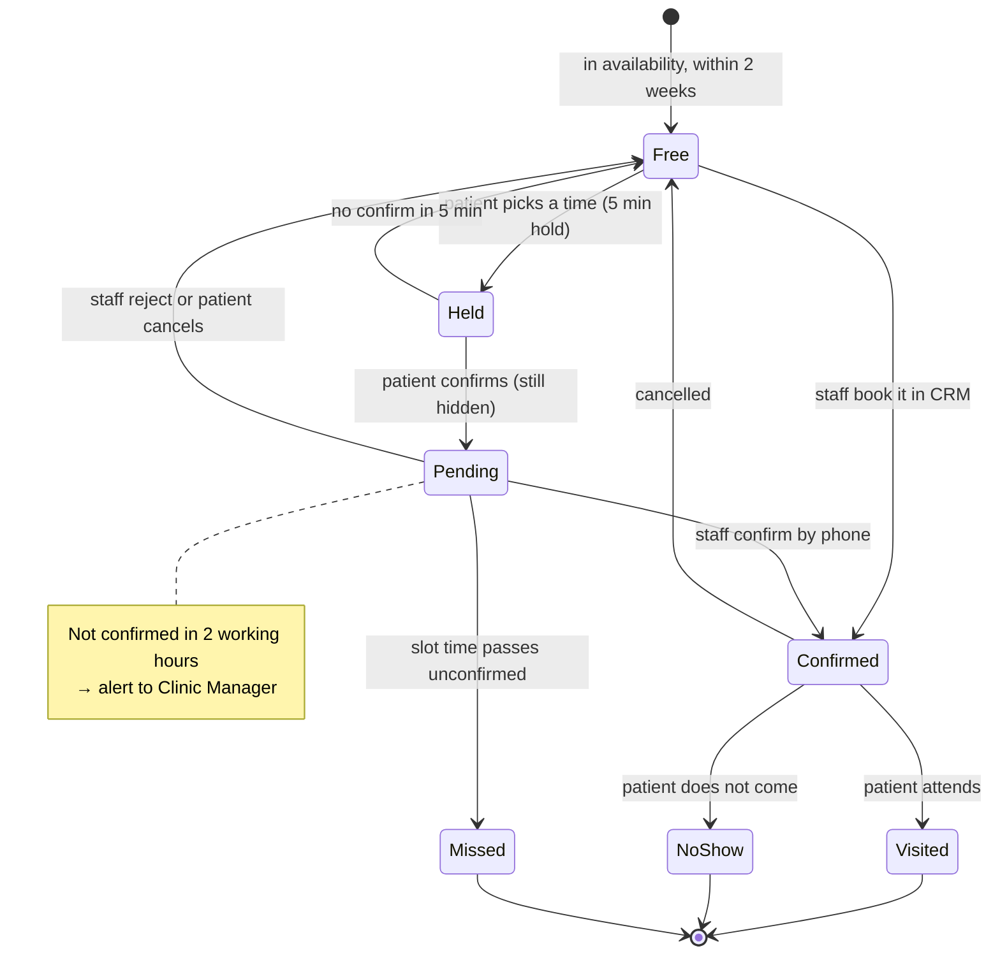
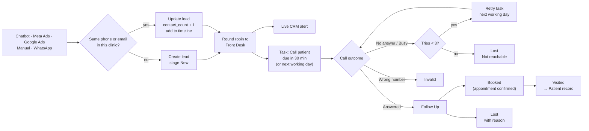
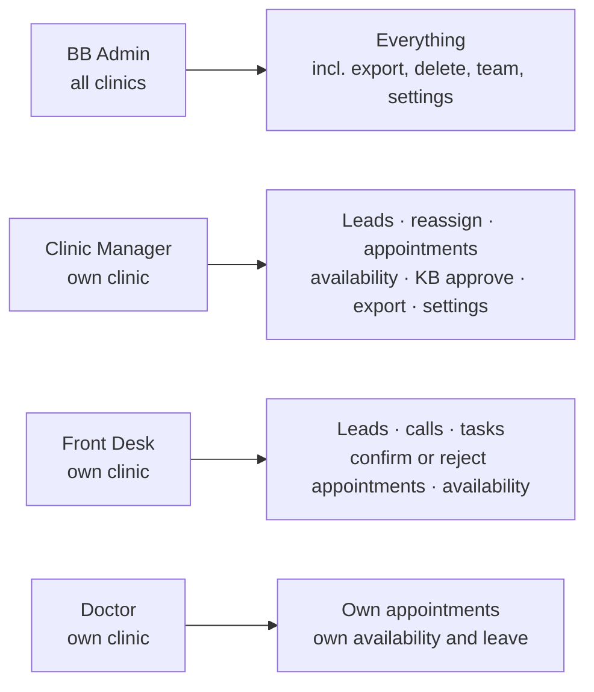
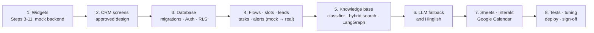

# Plan diagrams

Pictures of the design in [RAG-AND-LEADS.md](RAG-AND-LEADS.md). GitHub draws them automatically. In VS Code, open the Markdown preview (a Mermaid extension may be needed).

---

## 1. Whole system

---

## 2. Answer pipeline (one message)

---

## 3. Booking and slot life cycle

Only **Free** slots are ever shown in the chatbot. The database blocks two active bookings on the same doctor and time.

---

## 4. Lead life cycle and follow-up

---

## 5. Who can do what in the CRM

Every stage change, assignment, export and delete is written to the audit log.

---

## 6. Build order

